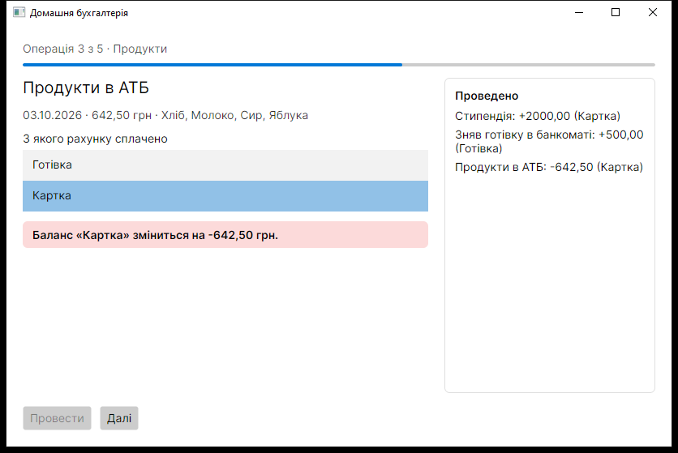
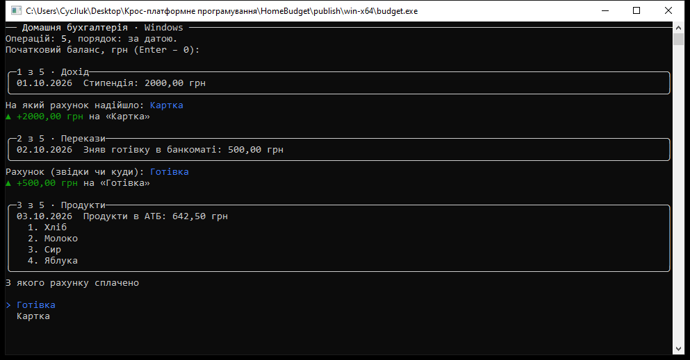
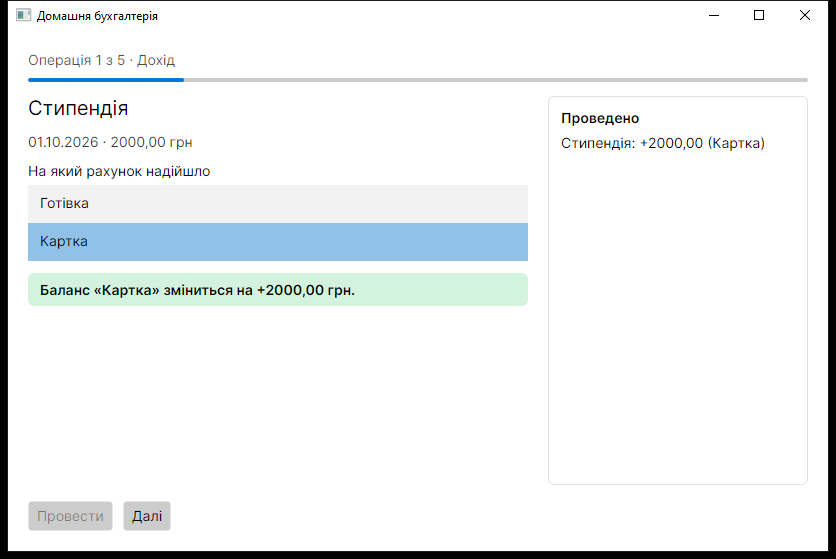
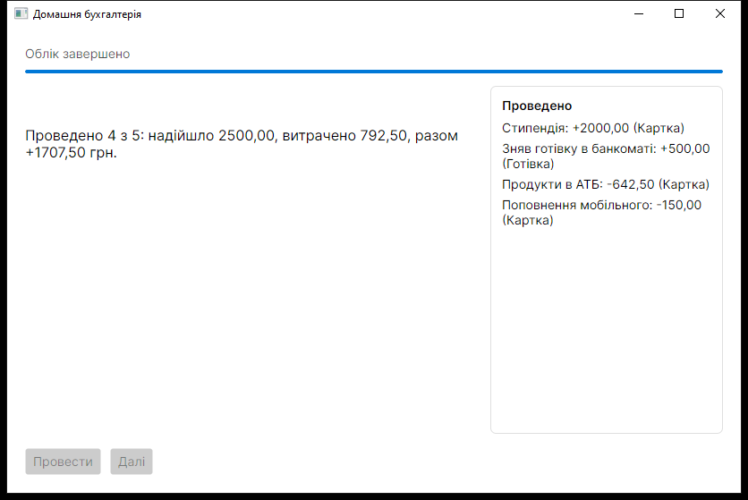

# HomeBudget — Домашня бухгалтерія

**Тема проєкту:** «Домашня бухгалтерія» (тема 11 з додатка А).

Застосунок на .NET 10 для обліку особистих фінансів. Він веде журнал витрат, надходжень і переказів між рахунками. Користувач проводить кожну операцію за своїм рахунком і бачить, як змінюється баланс, а наприкінці отримує підсумок. Одне ядро має дві оболонки: консольну (Spectre.Console) і віконну (Avalonia UI). Обидві працюють у Windows, macOS і Linux.



## Карта назв

| Роль у кістяку | У прикладі | Домашня бухгалтерія |
|---|---|---|
| Основний тип | `Card` | `Transaction` |
| Різновид 1 | `OpenAnswerCard` | `Expense` (витрата) |
| Різновид 2 | `ChoiceCard` | `Income` (надходження) |
| Різновид 3 | `NumericCard` | `Transfer` (переказ між рахунками) |
| Спільна дія | `Check(answer)` | `BalanceEffect(account)` — вплив на баланс рахунку |
| Набір записів | `List<Card> deck` | `List<Transaction> transactions` |
| Сховище | `ICardStorage` | `ITransactionStorage` |
| Порядок перебору | `IReviewStrategy` | `ITransactionOrder` |
| Підсумок | `SessionSummary` | `BalanceSummary` |

Четвертий різновид, `InstallmentPurchase` («Оплата частинами»), підключається як окремий складник (ЛР 8).

## Будова

| Каталог | Що це |
|---|---|
| `HomeBudget.Core/` | бібліотека-ядро: операції, сховище JSON, порядок перебору, ядро обліку `LedgerSession`, каталог різновидів, завантажувач складників |
| `HomeBudget.App/` | консольна оболонка на Spectre.Console (`budget`) |
| `HomeBudget.Desktop/` | віконна оболонка на Avalonia UI (`budget-ui`) |
| `plugins/HomeBudget.Transactions.Installment/` | складник із четвертим різновидом «Оплата частинами» |
| `tools/BudgetReport/` | окремий застосунок, що підключає ядро пакетом NuGet |

## Дві оболонки над одним ядром

**Консоль (`HomeBudget.App`).** Кожна операція показана в рамці, а рахунок обирають стрілками. Вплив на баланс підсвічено зеленим або червоним. Наприкінці виводяться підсумок і таблиця операцій, які варто перевірити. Якщо введення перенаправлене з файлу, оболонка читає відповіді рядками.



**Вікно (`HomeBudget.Desktop`).** Тут ті самі операції, але рахунок обирають у списку. Під кожну операцію вікно добирає шаблон даних за типом: для витрати, надходження й переказу це список рахунків, для різновиду зі складника — поле введення. Відгук підсвічується кольором через стилі, смуга показує поступ, а праворуч ведеться журнал проведених операцій.

| Надходження | Підсумок |
|---|---|
|  |  |

**Межа між ядром і оболонкою.**
- Уся логіка обліку лежить у `HomeBudget.Core`: який рахунок зачіпає операція, як змінюється баланс, що варто перевірити. У ядрі немає жодного `Console`, Spectre чи Avalonia.
- Оболонки лише показують дані й передають ядру назву рахунку.
- Заради вікна в ядрі не змінено жодного рядка. Файл коду вікна `MainWindow.axaml.cs` містить самий лише конструктор.

## Як запустити

Потрібен .NET SDK 10.

```
dotnet run --project HomeBudget.App
dotnet run --project HomeBudget.Desktop
dotnet run --project HomeBudget.App -- --info     # відомості про систему
dotnet run --project HomeBudget.App -- --kinds    # відомі різновиди операцій
```

## Збірки для трьох систем

Зібрати все однією командою: `./publish.sh` (Linux, macOS, Git Bash) або `publish.ps1` (PowerShell). Результат з'явиться в `publish/<RID>/<оболонка>/`.

| RID | Для кого | Консоль | Вікно |
|---|---|---|---|
| `win-x64` | Windows 10/11, 64-розрядний | `HomeBudget.App\budget.exe` | `HomeBudget.Desktop\budget-ui.exe` |
| `osx-arm64` | macOS на процесорах Apple (M1 і новіші) | `HomeBudget.App/budget` | `HomeBudget.Desktop/budget-ui` |
| `linux-x64` | Linux, 64-розрядний | `HomeBudget.App/budget` | `HomeBudget.Desktop/budget-ui` |

Збірки самодостатні: .NET на цільовій машині не потрібен. Що може завадити запуску:
- **Linux і macOS:** після копіювання чи розпакування zip потрібно знову виконати `chmod +x budget budget-ui`.
- **macOS:** файл, завантажений з мережі, потрапляє в карантин; зняти його можна командою `xattr -d com.apple.quarantine budget`.
- **Linux:** потрібна бібліотека ICU (`libicu`). Віконній оболонці ще потрібні `libx11-6`, `libice6`, `libsm6` і `libfontconfig1`.
- **Windows:** політика PowerShell `Restricted` не дає запустити `publish.ps1`. Я збирав через `bash publish.sh`.

Журнал зберігається в каталозі даних користувача: `%APPDATA%\HomeBudget\transactions.json` у Windows і `~/.config/HomeBudget/transactions.json` у Linux та macOS.

Автор: Кокорін Тарас, група 33 Бд-СОінф.
